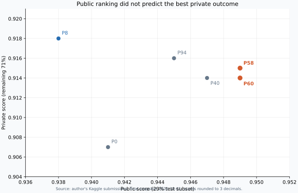

# 3D Cell Tracking: a Biohub competition case study

**An evidence-led account of adapting a public tracking pipeline, testing graph-level changes, and learning where leaderboard selection failed.**

[中文完整报告](docs/REPORT.zh-CN.md) · [English report](docs/REPORT.en.md) · [Code and attribution](docs/PROVENANCE.md) · [Competition](https://www.kaggle.com/competitions/biohub-cell-tracking-during-development/)

| Final submitted candidate | Public score | Private score | Final leaderboard |
| --- | ---: | ---: | ---: |
| P58: sparse-frame detector + density-aware linking + leaf policy | **0.949** | **0.915** | Public rank **1110**; private leaderboard position **1364** |

Scores and leaderboard positions are from the [frozen Kaggle API snapshot](evidence/kaggle_results_2026-10-01.json) collected on 2026-10-01. P60, the second pre-deadline selection, scored 0.949 / 0.914. Scores are rounded to three decimals. The final outcome was an engineering and research-learning result, not a podium finish.



## The problem and my scope

The [Biohub challenge](https://www.kaggle.com/competitions/biohub-cell-tracking-during-development/) asks for cell detections and temporal lineage links in 3D zebrafish microscopy. The output is a graph: cells are nodes, inter-frame associations are edges, and divisions create branches. Hidden test embryos differ from the training embryos; the public leaderboard covers about 29% of the hidden test set, leaving about 71% for the final private score.

The project **started from publicly shared notebooks and checkpoints**. I did not train the main 3D detector or temporal linker from scratch. The work here was to audit that backbone, integrate controlled post-processing changes, verify that changes actually reached the final graph, and manage reproducible Kaggle releases. [Sources and ownership are listed explicitly.](docs/PROVENANCE.md)

```mermaid
flowchart LR
    A[Public detector and linker checkpoints] --> B[3D detections and candidate edges]
    B --> C[Graph optimization]
    C --> D[Density-conditioned motion gates]
    D --> E[Sparse-frame detector and weak-leaf policy]
    E --> F[Lineage-aware coordinate smoothing]
    F --> G[Schema, coverage, graph and hash audit]
    G --> H[Kaggle code submission]
    style A fill:#e6edf5,stroke:#64748b
    style D fill:#fff0d7,stroke:#b45309
    style E fill:#fff0d7,stroke:#b45309
    style F fill:#fff0d7,stroke:#b45309
    style G fill:#def4e8,stroke:#15803d
```



The blue stage is upstream work; orange stages show the main experiment mechanisms; green is the release audit. Each numbered candidate was built from a pinned parent and assessed separately.

## Three concrete contributions

1. **Found a silent density-gate wiring error.** The original post-processing function received per-density `tight`/`relaxed` distances but its matching loop read global constants instead. P53 made the loop consume the passed values. A four-node synthetic case changed from one edge to two; a raw-node identity comparison then confirmed nonzero changes in the scored output graph. P53 reached 0.949 Public / 0.914 Private, although the combined submission does not isolate the bug fix's causal effect.
2. **Tested a detector–linker–filter interaction.** P58 combined sparse-frame detector replacement, the effective density gates, and weak-leaf pruning outside the high-density group. The run passed source/hash, full-frame coverage, CSV, and graph checks. It scored 0.949 Public / 0.915 Private.
3. **Protected divisions from trajectory smoothing.** P60 stopped its local linear fit at lineage branches rather than blending a daughter with its parent track. On four visible videos, graph node IDs and edges stayed fixed while 344 final coordinates changed. It scored 0.949 Public / 0.914 Private.

## What the final scores taught me

| Candidate | Public | Private | Why it matters |
| --- | ---: | ---: | --- |
| P0 public-backbone control | 0.941 | 0.907 | Reproduced starting reference |
| P53 density-gate + detector + leaf combination | 0.949 | 0.914 | Controlled joint change |
| **P58 final selection** | **0.949** | **0.915** | Best of the two pre-deadline choices |
| P60 second final selection | 0.949 | 0.914 | Different failure mode, same rounded Public |
| P8 earlier D4 experiment | 0.938 | **0.918** | Lower Public, higher Private in hindsight |
| P94 later fusion experiment | 0.945 | 0.916 | Another Public/Private ranking reversal |

Relative to P0, P58 improved both displayed scores by **0.008**. This is an observed end-to-end difference across multiple changes, **not** proof that any single modification caused the gain. The P8 result shows a real selection limitation: a candidate that looked poor on Public turned out to be stronger on the hidden 71%. The visible local videos overlapped training for the public checkpoints, so their labels were used for structural diagnosis, not treated as an independent generalization test.

## Run the small code companion

This repository includes **synthetic-graph demonstrations**, not the complete scored Kaggle Notebook. They show the fixed density gates, P58-style one-pass leaf policy, P60 lineage window, and structural validation without competition data or model weights.

```bash
PYTHONPATH=src python -m unittest discover -s tests -v
python scripts/verify_evidence.py
# Optional figure regeneration: python -m pip install matplotlib
python scripts/plot_score_gap.py
```

On PowerShell, set `$env:PYTHONPATH = "src"` before running the tests. `verify_evidence.py` checks the displayed score arithmetic against the frozen snapshot; it does not fetch or recompute Kaggle scores.

## Repository map

- [`docs/REPORT.zh-CN.md`](docs/REPORT.zh-CN.md): full Chinese project report and résumé bullets.
- [`docs/REPORT.en.md`](docs/REPORT.en.md): English case-study version.
- [`docs/PROVENANCE.md`](docs/PROVENANCE.md): upstream credit, AI assistance, publication and reproduction limits.
- [`src/biohub_case_study/`](src/biohub_case_study/): isolated mechanism examples.
- [`tests/`](tests/): synthetic graph and safety cases.
- [`evidence/`](evidence/): this team's score snapshot and key artifact identities only.

The [competition data](https://www.kaggle.com/competitions/biohub-cell-tracking-during-development/data), upstream weights, full scored Notebooks, and submission CSVs are intentionally not redistributed. The [official RoyerLab metric](https://github.com/royerlab/kaggle-cell-tracking-competition) is linked rather than vendored. The examples in this repository use the MIT license; upstream work retains its own terms and credit.
