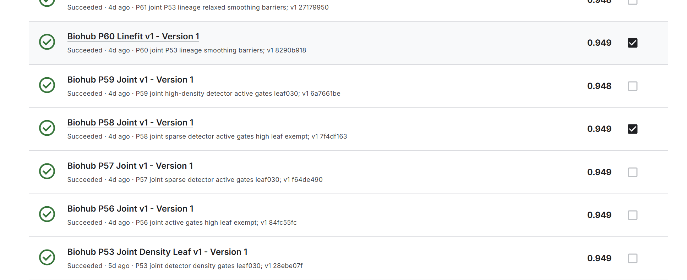

# Biohub 3D 细胞追踪竞赛：从公开基线到可审计实验的项目复盘

> **项目定位：** 大三阶段的计算机视觉与科研工程实践。目标是积累处理真实科学数据、改造复杂推理流水线和判断实验可信度的经验；最终成绩如实呈现，不以名次替代技术贡献。

**时间：** 2026 年 9 月 · **任务：** 斑马鱼胚胎 3D+时间显微影像的细胞检测、跨帧关联与谱系重建 · **最终展示成绩：** Public **0.949**，Private **0.915**；2026-10-01 榜单快照中 Public 排名 **1110**、Private 列表位置 **1364**。成绩和提交编号见[官方 API 快照](../evidence/kaggle_results_2026-10-01.json)。

*截止前的选择截图；最终分数另以赛后 Kaggle API 快照为准。*

## 1. 我解决的是什么问题

[Biohub 竞赛](https://www.kaggle.com/competitions/biohub-cell-tracking-during-development/)要求从 `(T, Z, Y, X)` 荧光显微影像生成追踪图：节点表示某帧的细胞，边表示相邻帧的关联，分裂形成双子分支。困难不只在“找到亮点”：密集细胞、各向异性体素、运动和分裂会让检测误差传入关联与谱系，最终仍须满足严格的 CSV、时间和图结构要求。

我以[公开社区 Notebook](https://www.kaggle.com/code/anhadmahajan06/biohub-track-your-cells-development)及公开权重作为工程起点，复核其 3D 检测、时序边打分、图优化和后处理，再围绕**检测、关联、图清理与定位**做固定配方实验。主干检测器和关联器并非我从零训练；项目贡献是源码审计、机制修复与组合、合成图验证、产物验收和结果分析。引用及公开边界见[来源说明](PROVENANCE.md)。

## 2. 关键技术工作

### 2.1 找到“日志显示生效、计算却未生效”的关联门问题

父本 P50 按影片密度计算并传入 `tight_um`、`relaxed_um`，但实际两轮匹配循环仍使用全局常量。也就是说，日志里的 low/middle/high 门值并未真正控制连边。P53 将循环改为读取函数收到的值，固定使用 low `7.25/11`、middle `6.5/9`、high `5.5/10` 微米；没有在可见标签上重新扫描阈值。

我先用四节点合成竞争图检查控制流：旧实现只选 `(2,3)`，修复后 middle 组选择 `(1,3)` 与 `(2,4)`。随后比对 P50/P53 的上游 GEFF 文件树哈希，证明共同原始节点 ID 可精确对齐；在三个低/中密度可见视频上，共同节点的最终边集合分别改变 **1.238% / 0.743% / 0.439%**，高密度组因门值不变，边集合改变 **0%**。这证明修复进入了终图，**不证明单项修复提升了泛化分数**。P53 同时包含检测替换和弱叶清理，Public 0.949 / Private 0.914 只能作为整个组合的外部结果。

### 2.2 检测、关联和弱叶规则的交互实验

P58 在 P53 父本上收窄第三检测器的替换区域，仅用于稀疏帧，并让边概率低于 0.30 的非末帧终端弱叶在低/中密度组被一次性删除；高密度组豁免该规则。无学习分数的安全分裂边也豁免，避免把它们误当低置信边。选择这组规则的动机是：扩大检测覆盖可能带来真细胞，也可能带来伪点；关联与清理必须同时考虑，不宜只扩大候选数量。

正式 P58 产物通过 Notebook 源码与权重身份、四部可见视频各 100 帧覆盖、CSV schema、坐标范围和图约束检查；运行记录显示第三检测替换按四片为 `0/0/36/0`，弱叶实际删去 20 个节点，高密度豁免生效。它的 Public/Private 为 **0.949/0.915**。这些四片与公开权重的训练数据有重叠，因此这里只把它们用于**机制和结构验收**，不把其本地分数当独立胚胎验证。

### 2.3 让轨迹平滑尊重分裂边界

原线性轨迹拟合在女儿节点向后取邻域时，可能沿分裂边走进母细胞轨迹，把不同谱系的定位一起平滑。P60 只改变邻域遍历：若边两端不是一对一的延续关系，拟合在该边停止。模型、检测预算、关联门、弱叶规则和图拓扑保持 P53 配方。合成分裂图先验证女儿不会再混入母轨迹；正式四片中节点 ID、帧和边集合与 P53 逐项一致，**344 个最终坐标发生变化**，证明改动不是只写了日志。P60 Public **0.949**、Private **0.914**。P60 与 P58 在截止前作为两种风险方向的最终候选；三位小数 Public 相同，并不代表 Private 表现相同。

## 3. 如何避免“运行成功 = 实验成功”

实验采用“固定父本与源码/权重 SHA → 合成图证明机制 → Kaggle 私有离线普通运行 → 远端版本及源码核对 → 产物结构审计 → 单次正式提交”的顺序。每个候选至少确认：代码版本身份、输入来源、完整帧覆盖、CSV 列、节点与边的引用关系、时间方向、坐标范围，以及与父本的精确图差分。Kaggle CLI 没有返回提交 ID 时，也不因补 ID 而重复提交；先保存本地意图与回执，再用平台记录对账。

其中一次审计还暴露了**验证器自身的问题**：按 1 µm 坐标互近邻匹配 P50/P53，会把同一个原始节点因后续平滑位移而误判为不同节点。保留原失败回执后，我改为先验证上游文件字节一致，再按原始 ID 比边。这件事让我理解：实验门槛只有在身份定义正确时才有意义。

## 4. 结果与更重要的反例

| 候选 | 作用 | Public | Private |
| --- | --- | ---: | ---: |
| P0 | 公开主干的复现控制 | 0.941 | 0.907 |
| P53 | 检测 + 生效密度关联门 + 弱叶规则 | 0.949 | 0.914 |
| **P58** | 稀疏帧检测 + 密度关联 + 高密度弱叶豁免；最终候选 | **0.949** | **0.915** |
| P60 | P53 + 谱系边界平滑；第二最终候选 | 0.949 | 0.914 |
| P8 | 较早的 D4 方案 | 0.938 | **0.918** |
| P94 | 后期融合方案 | 0.945 | 0.916 |

P0→P58 的显示分数在 Public 和 Private 都增加 **0.008**，但这是多处改动的**端到端观察**，不能归因到单一组件。更值得复盘的是：P8 的 Public 比 P58 低 **0.011**，Private 却高 **0.003**。P94 也出现 Public 较低、Private 较高。这不是事先能够可靠预见的胜负，却说明最终按 Public 及机制多样性选择 P58/P60 仍有盲区。Public 只覆盖约 29% 隐藏数据且只显示三位小数；可见四片又与公开权重训练重叠。赛后我会更重视真正隔离的胚胎级验证，以及对候选选择的不确定性说明。

最后一批 P96–P100 在平台被受理，但[快照](../evidence/kaggle_results_2026-10-01.json)中的 Public/Private 字段为空，因此不计入有效成绩，也不写成“冲刺成功”。

## 5. 简历中可以如何表述

> **Biohub 3D 细胞追踪竞赛项目｜Python、计算机视觉、图优化、实验工程**
>
> - 基于公开 3D 检测和时序关联主干，定位并修复密度门参数未进入匹配循环的问题；通过合成图和上游原始节点 ID 对照验证，三个低/中密度视频的终图共有节点边集合变化 0.439%–1.238%。
> - 设计稀疏帧检测、密度感知关联和弱叶清理的联合候选；构建源码/权重 SHA、100 帧覆盖、CSV/图约束及单次提交审计，最终候选取得 Public 0.949 / Private 0.915。
> - 复盘 Public/Private 排序倒置：较早候选 P8 为 0.938 / 0.918，指出可见训练重叠视频不能充当跨胚胎验证，并明确完整模型依赖公开权重。

## 6. 可运行材料与边界

仓库中的 [`src/biohub_case_study/`](../src/biohub_case_study/) 把三个后处理决策缩成不依赖权重的**合成图示例**；[`tests/`](../tests/)覆盖弱叶豁免、分裂屏障和非法图；[`scripts/verify_evidence.py`](../scripts/verify_evidence.py)复核成绩快照中的算术。它们可以供面试讨论与代码审阅，**并非完整 Kaggle 推理脚本，不能凭这些文件复现 0.915**。正式系统依赖竞赛数据、公开模型权重和原 Kaggle 运行环境，本仓库不重新分发它们。开发过程中使用过 AI 编程助手；所有外部来源、模型所有权与本项目改动在[来源说明](PROVENANCE.md)中分别列出。
